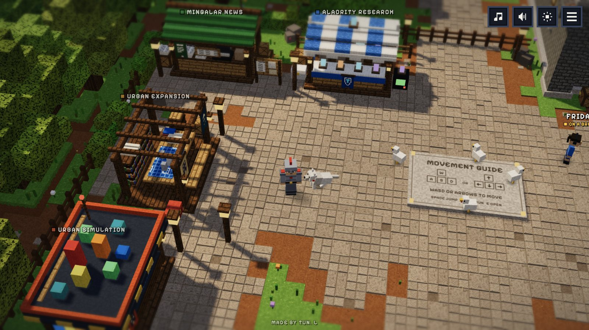
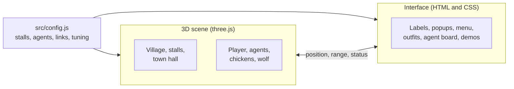

<div align="center">

# MyCraft Dungeon

**A portfolio you walk around in: a small blocky village where every market stall is a project and the town hall is staffed by AI agents.**

*Made by Tun. L*

[](https://threejs.org)
[](https://vitejs.dev)
[](#how-it-works)
[](#controls)

<!-- Replace https://YOUR-SITE with the deployed address, here and in index.html -->
**[Visit the village →](https://YOUR-SITE)**



</div>

<br>

A portfolio is usually a page of cards. This one is a place.

You arrive in a village square with a character you can walk, run and jump with. Each market stall
stands for one project: walk up, press <kbd>E</kbd>, and it opens with a screenshot, a short
description and a link. Past the square is a town hall where four villagers sit at their desks.
Each one is an AI agent I have built or am building, and each will show you what it does.

It runs in the browser on a phone or a laptop, with no install and no server.

<br>

## A walk through the village

<table>
<tr>
<td width="50%" valign="top">

**1. Open a project.** Six stalls ring the square. Walk up to one and press <kbd>E</kbd>, or just
click or tap it. The menu in the corner will walk you there.


</td>
<td width="50%" valign="top">

**2. Change your outfit.** The Outfits stall has twelve characters, from Adventurer to Night Watch,
each with their own hair, hat and gear. Your pick is remembered.


</td>
</tr>
<tr>
<td width="50%" valign="top">

**3. Step into the town hall.** The roof fades as you walk in. The agents type at their desks,
wander the carpets, and stroll out to the stall they work for.


</td>
<td width="50%" valign="top">

**4. Read the agent board.** Pick an agent to see what they do, when they run, what they deliver
and where they are right now, then call them to the meeting table.


</td>
</tr>
</table>

Open every stall and a wolf starts following you around.

<br>

## The projects

| Stall | What it is | Link |
|---|---|---|
| **Mingalar News** | A media organization for Myanmar migrants in Thailand, expanding into data-driven market insights on this community. | [mingalar.news](https://mingalar.news) |
| **Alacrity Research** | An internal CRM to visualize and manage real estate projects, with an AI voice assistant that learns as you use it. | [map.alacrityresearch.xyz](https://map.alacrityresearch.xyz) |
| **Urban Expansion** | A mathematical framework for how cities grow outward, tested on Yangon. | [Read the paper](https://drive.google.com/file/d/12T6Tg6l2Z3MKGV9wCo5UdtmauGHceIt2/view?usp=sharing) |
| **Urban Simulation** | A simulated heat map for investments based on the findings of Urban Research. | Coming soon |
| **Contact Me** | Want to work together or talk through an idea? | [tunpyaysonelin@gmail.com](mailto:tunpyaysonelin@gmail.com) |

<br>

## Meet the agents

<table>
<tr>
<td width="50%"></td>
<td width="50%"></td>
</tr>
<tr>
<td><b>Friday</b> answers a question about the Alacrity Research map.</td>
<td><b>Sally</b> grows a city year by year and checks the model against it.</td>
</tr>
</table>

| Agent | Role | Works for | Runs |
|---|---|---|---|
| **Bobby** | News scraper. Reads Thai and Myanmar news sources, removes duplicates, and ranks what matters to Myanmar migrants in Thailand. | Mingalar News | Every day at 10:30am Bangkok time |
| **Friday** | Personal assistant. Answers questions about plots, tasks and progress, by text or by voice. | Alacrity Research | Whenever she is asked |
| **Sally** | Researcher. Gathers city growth data and tests the urban expansion model against it. | Urban Expansion | Whenever she is asked |
| **Edwin** | Financial advisor. Watches a portfolio against its targets and flags what needs attention. | Urban Simulation | Every weekday at 8:00am Bangkok time |

Walk up to an agent and press <kbd>E</kbd> to try their demo. Their name tags show whether they
are working, on a break or on their way to the table, and speech bubbles pop up as they finish a
piece of work.

> **What is real and what is a demo.** The projects and their links are real. Inside the hall,
> every demo, the activity log and the "last run" lines run in your browser on sample data.
> Nothing is fetched, sent or triggered. Connecting the villagers to the real agents is the next
> step (see [Status](#status)).

<br>

## Quick start

**You need:** [Node.js](https://nodejs.org) 18 or newer.

```bash
git clone https://github.com/Tun-PS-Lin/MyCraft_Dungeon
cd MyCraft_Dungeon

npm install
npm run dev      # local preview at http://localhost:5173
npm run build    # production build in dist/
```

**Put it online.** On [Vercel](https://vercel.com), choose *Add New → Project*, pick this
repository and press Deploy. Vercel detects Vite on its own (build command `npm run build`, output
folder `dist`). For GitHub Pages or any other static host, run `npm run build` and upload the
contents of `dist/`.

<br>

## Controls

| Action | Keyboard and mouse | Phone |
|---|---|---|
| Move | <kbd>W</kbd> <kbd>A</kbd> <kbd>S</kbd> <kbd>D</kbd> or arrow keys | On-screen stick |
| Walk to a spot | Click the ground | Tap the ground |
| Run | Hold <kbd>Shift</kbd> | Push the stick to its edge |
| Jump | <kbd>Space</kbd> | Jump button |
| Open a stall, talk to an agent, read the board | <kbd>E</kbd> when near, or click it | The yellow button, or tap it |
| Close | <kbd>Esc</kbd>, <kbd>E</kbd> or × | × |
| Zoom a little | Scroll, or <kbd>+</kbd> and <kbd>-</kbd> | Pinch |

The buttons in the top-right corner are music, sound effects, day or night, and the menu. On
phones, music and sound move into the menu under Settings. A fresh visit opens in day or night to
match the visitor's clock. Music and sound settings, the chosen outfit, explored stalls and the
wolf are remembered in the visitor's browser.

<br>

## How it works



- **Everything is built in code.** There are no model or texture files: every block texture is a
  16 pixel canvas painted at start-up, and every stall, villager and outfit is assembled from boxes.
- **The 3D scene** is plain three.js with a fixed camera that follows the player. Collision, the
  walk-to path finding and the agents' behaviour are small hand-written modules, not a game engine.
- **The interface** is ordinary HTML and CSS on top of the canvas, so popups and menus stay sharp
  and readable at any size.
- **Built to run on phones.** Repeated blocks are drawn as instances, static buildings are merged
  into a few meshes, and the world's shadows are rendered once at start-up.

<br>

## Make it yours

Everything you are likely to edit is in **`src/config.js`**:

| Setting | What it changes |
|---|---|
| `STALLS` | Each stall's name, description, link, popup picture, map position and facing. An empty `url` shows "Link coming soon". |
| `AGENTS` | Each agent's name, role, desk, greeting, and the text on the agent board. |
| `CONTACT_EMAIL` | The address in the Contact popup. |
| `INTRO_NAME`, `CREDIT`, `REPO_URL` | The opening title card and the credit line at the bottom of the screen. |
| `MUSIC_FILE`, `MUSIC_VOLUME`, `SOUND_FILES` | The background track and real sound effects. |
| `TUNING` | Walk and run speed, jump height, camera angle and distance, zoom range. |
| `LANGUAGE_TOGGLE` | Set to `true` to bring back the English and Burmese button. All the Burmese text is in place. |
| `LIVE_STATUS_URL` | A JSON endpoint for real "last run" lines on the agent board. |

Interface wording in both languages is in **`src/i18n.js`**. How each agent looks is set in
`LOOKS` and their work lines in `WORK`, both at the top of **`src/agents.js`**. Each agent's demo
is a small function in **`src/demos.js`**.

<details>
<summary><b>Link preview image</b></summary>

<br>

This is the card shown when the site address is pasted into Telegram, LinkedIn, Facebook, X and so on.

1. The picture is already in place as **`public/og-image.jpg`** (1200 × 630 pixels). Replace that file to change it.
2. Deploy the site once so you know its address.
3. Open **`index.html`** and replace `https://YOUR-SITE` with your real address in the two `og:` lines near the top (for example `https://mycraft.vercel.app`). The image address must be the full address, not a relative path.
4. Commit, push, and let Vercel redeploy.
5. Check it by pasting your address into https://www.opengraph.xyz or by sending the link to yourself on Telegram. Apps cache previews; on Telegram, send the link to `@WebpageBot` to refresh it.

</details>

<details>
<summary><b>Add your own sounds and visuals</b></summary>

<br>

Until you add files, every sound effect is a small synthesized placeholder and every texture is
generated in code, so the site works with nothing but the music track in `public/assets/`.

### Sounds

Put `.mp3` or `.ogg` files in `public/assets/sounds/` and list them in `SOUND_FILES` in `src/config.js`:

```js
export const SOUND_FILES = {
  step: ['step1.mp3', 'step2.mp3', 'step3.mp3'],
  jump: ['jump.mp3'],
};
```

| Key | Used for | Suggested |
| --- | --- | --- |
| `step` | footsteps | 3 to 4 short variants |
| `jump`, `land` | jumping and landing | one each |
| `open`, `close` | project popup | one each |
| `near` | walking into range of a stall | a soft blip |
| `menu` | menu opening and closing | one |
| `cluck` | startled chicken | 2 to 3 variants |
| `bird`, `cricket` | occasional bird call by day, cricket by night | 2 to 3 variants |
| `villager` | an agent greeting you | 2 to 3 short grunts |
| `bark` | the wolf | one |
| `achieve` | achievement unlocked | a short jingle |

Background music is `public/assets/sounds/background_music.mp3`. Replace the file, or point `MUSIC_FILE` at another one.

### Visuals

| What | Where it goes |
| --- | --- |
| Popup picture for each project | put a `.jpg` or `.png` (about 1100 px wide, 16:9) in `public/assets/images/` and name it in that stall's `image` field in `src/config.js` |
| Popup pixel icon | `ART` in `src/ui.js` |
| Block textures (16×16 PNG) | `src/textures.js` (replace a generated canvas with a loaded image) |
| Stall models (`.glb`, e.g. from Blockbench) | `src/stalls.js` (load the model in place of that stall's builder) |
| Outfits | add an entry to `OUTFITS` in `src/figures.js`: colours, a hairstyle, and a `gear` list of raised pieces (hats, belt, backpack, pouches, cape, boots ...). New pieces go in `GEAR` in the same file |
| Favicon | `public/favicon.svg` |

Use original or CC0 assets. Do not ship Mojang's own textures, sounds or font on a public site.

</details>

<br>

## Project layout

```
index.html          page markup (canvas, popup, menu, touch controls)
src/config.js       content, links, sounds, tuning
src/i18n.js         interface wording in English and Burmese
src/main.js         renderer, lights, input, camera, game loop
src/world.js        ground, paving stones, fences, forest, guide slab
src/stalls.js       the six stalls and their roofs
src/hall.js         the town hall, its fading roof, the desks and the agent board
src/agents.js       the agents: desk work, breaks outside, being called to the board
src/demos.js        the demo each agent shows when you talk to them (sample data only)
src/figures.js      the blocky people: outfits, painting, posing
src/player.js       the player's state and shadow
src/critters.js     chickens and the wolf
src/nav.js          path finding for walk-to
src/ambience.js     fireflies and drifting leaves
src/collision.js    the walkable area, steps and jumping onto things
src/textures.js     pixel textures, materials, instancing helpers
src/ui.js           labels, popup, menu, wardrobe, chat panel, agent board menu, achievement badge
src/audio.js        sound effects and music
src/lights.js       lanterns and the day/night colours (edit `MOOD` to retune either mode)
src/style.css       interface styling
scripts/build-preview.mjs   optional: bundles everything into one HTML file
docs/img/readme/    the screenshots used in this README
```

<br>

## Status

The village is complete and playable. Today it is:

- **A front end only.** The agents in the hall are demos on sample data. Connecting Bobby and
  Friday to their real workflows, and building Sally and Edwin, comes next.
- **English only.** The Burmese translation is written and switched off.
- **Developed on desktop Chrome.** Phone layouts and touch controls are built in; reports from
  Safari and real phones are welcome.
- **Pinned to three.js 0.128.** The lighting and colour handling are tuned for that version;
  upgrading changes how the scene looks and needs a pass over `src/main.js` and `src/textures.js`.

Issues and ideas are welcome.

<br>

## Credits

Designed and directed by [Tun. L](https://github.com/Tun-PS-Lin). The look is inspired by
Minecraft Dungeons, but every model, texture and icon here is original and generated by the code
in `src/`. No Mojang assets are used, and this project is not affiliated with Mojang or Microsoft.

<div align="center">
<br>
<sub>Built with Claude.</sub>
</div>
