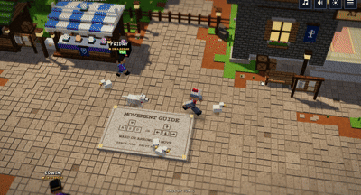
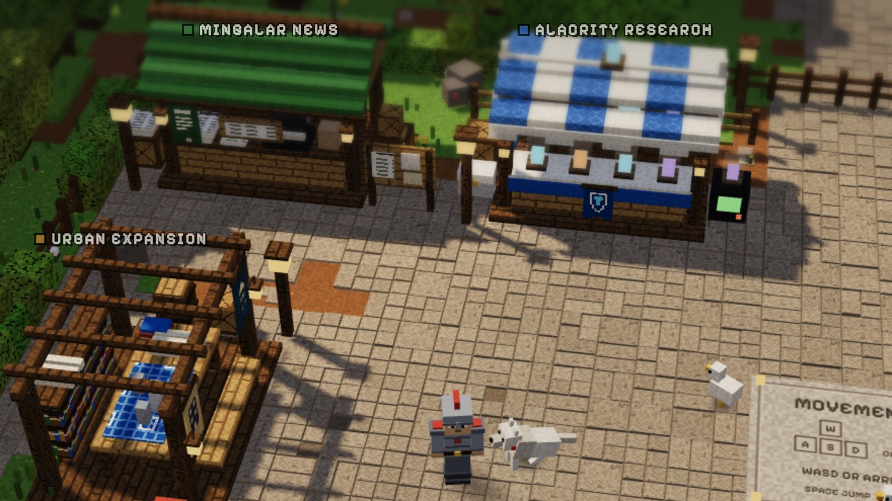
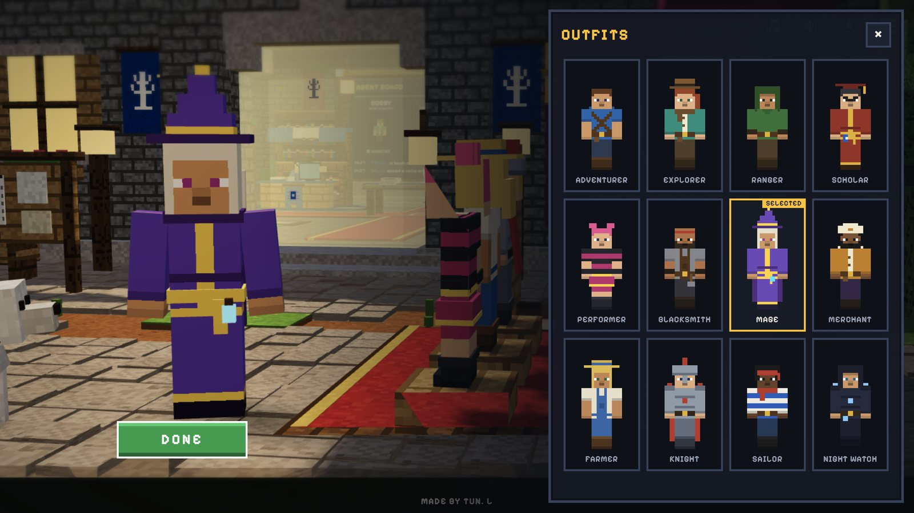
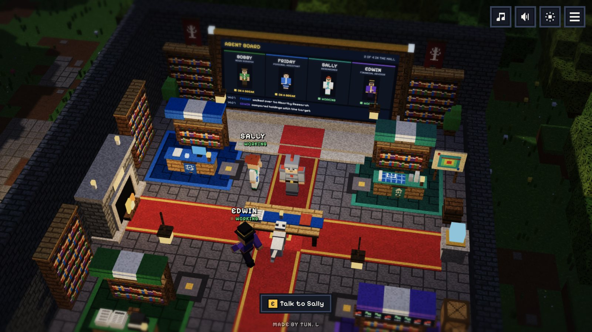
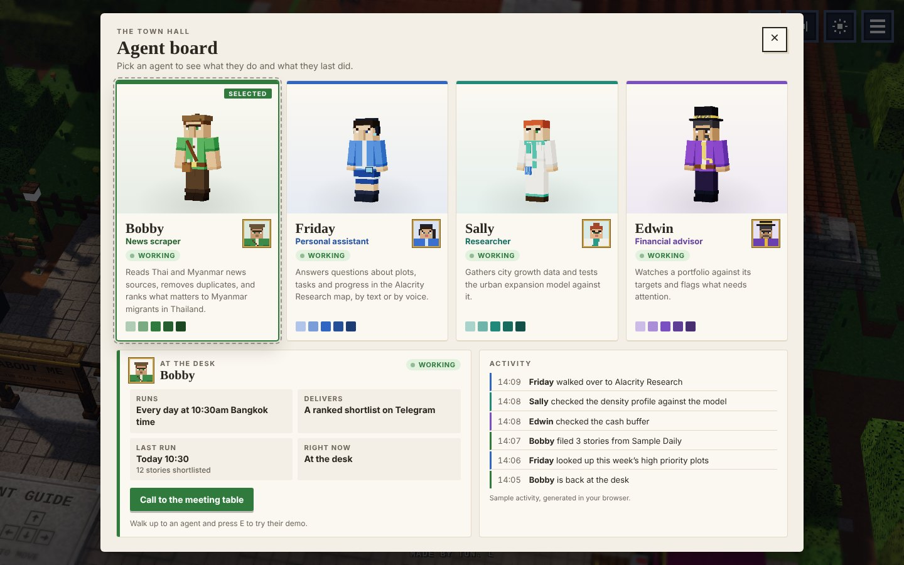
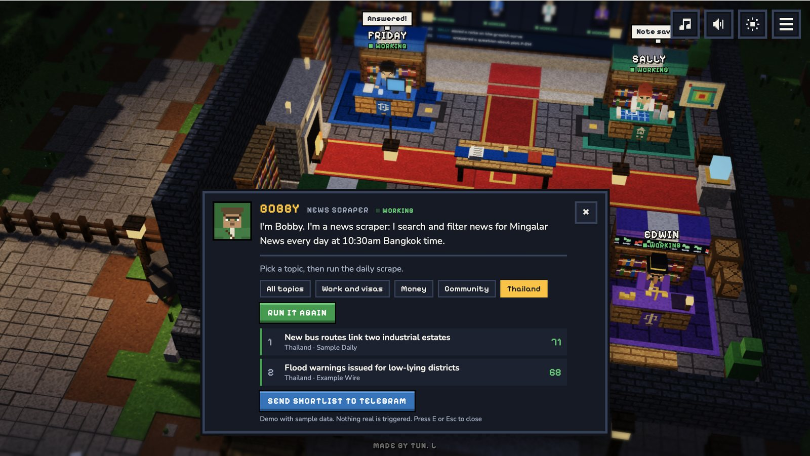
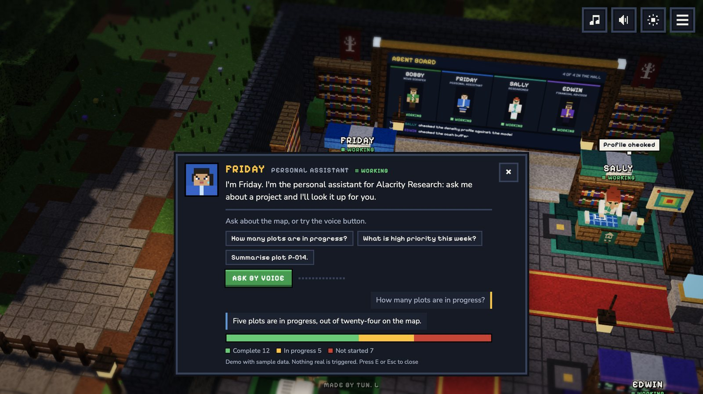
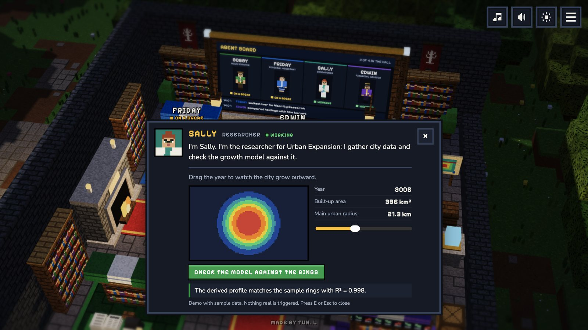
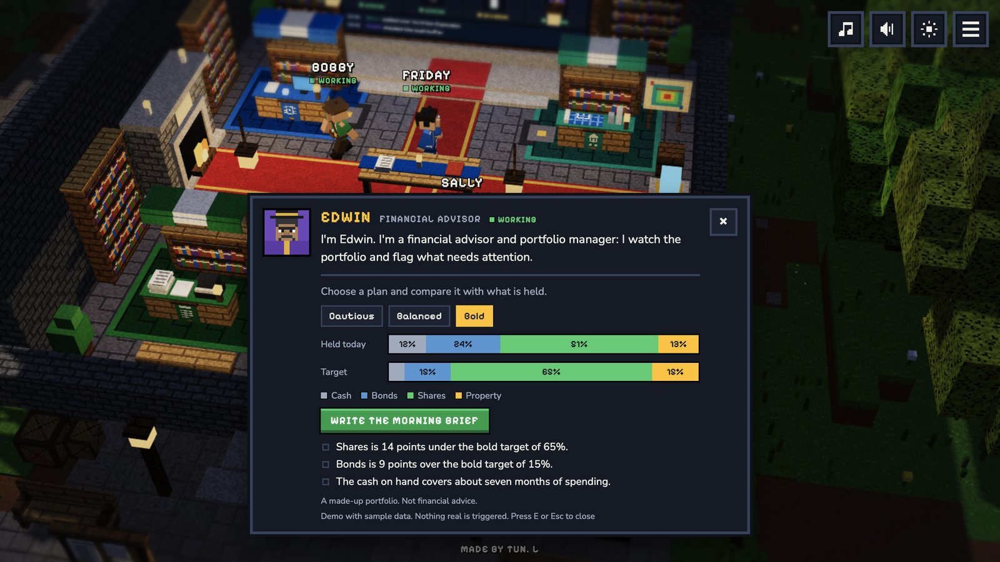

<div align="center">

# MyCraft Dungeon

**My portfolio, built as a little blocky village you can walk around.**

[**Play it**](https://portfolio.alacrityresearch.xyz) · [Simple version](https://portfolio.alacrityresearch.xyz/plain.html) · [Say hello](mailto:tunpyaysonelin@gmail.com)

[](LICENSE)
[](https://threejs.org)
[](https://portfolio.alacrityresearch.xyz)

<a href="https://portfolio.alacrityresearch.xyz"></a>

</div>

<br>

## What is this?

Hi, I'm Tun Pyay Sone Lin. I work in real estate and media, and I research how cities expand.
Instead of a page of project cards, I built a place: a village square where every market stall is
one of my projects, and a town hall where the AI agents I am building sit at their desks.

Walk up to anything and press <kbd>E</kbd>. It runs in the browser on a laptop or a phone, with
nothing to install.

<br>

## Explore the village

<table>
<tr>
<td width="33%" valign="top"><br><b>The stalls.</b> Each one opens a project with a screenshot, a short story and a link.</td>
<td width="33%" valign="top"><br><b>The outfits.</b> Twelve characters with their own hats and gear. The village remembers your pick.</td>
<td width="33%" valign="top"><br><b>The town hall.</b> The roof lifts away as you walk in, and the agents get on with their day.</td>
</tr>
</table>

A few small things to find: an **About Me** signpost above the movement guide, a day and night
switch, a dash roll (tap <kbd>Space</kbd> twice), a meeting table you can call the agents to, and a
wolf that starts following you once you have opened every stall.

<br>

## The Hideout

At the bottom of the square, a cave glows in the rock. Walk down the steps and you arrive in the
**Hideout**, a private room underground:

- **The CD player.** A shelf of CDs on the wall and a player on the cabinet. Its menu is a chunky
  retro deck: pick a CD and it swaps into the tray, with play, stop, skip and volume buttons and a
  little screen showing the track and time. The CD you pick keeps playing as you explore.
- **The journal.** An open book on a stand with my notes on mental models: second-level thinking,
  ergodicity, circles of competence, fat pitches, market cycles and more.
- **The gallery.** Framed paintings of my side projects, each with a link.
- **The library.** Bookshelves round an enchanting table. Browse the shelf, pull a book out, and read
  its title, author and my one-line takeaway. Ten books, from Poor Charlie's Almanack to The Martian.
- **Small rewards.** Read every journal entry (each gets a wax seal) to earn the **Scholar's Lantern**.
  Stand by the CD player while a CD plays and the room dims into **listening mode**.
- **The room.** A fireplace with a sleeping cat you can pet (it meows), a raised lounge, string lights at night, maps on the
  walls, and window light that moves with the time of day.
- **The window.** Sunny sky by day, stars by night, so you can tell the time even underground.

Everything in it lives in `src/hideout-content.js`: the CDs (`RECORDS`), the journal (`JOURNAL`) and
the paintings (`GALLERY`) and the books (`BOOKS`). Book covers go in `public/assets/images/books/`. Songs go in `public/assets/sounds/`, CD art in `public/assets/images/cds/`.

<br>

## On display

| Stall | What it is | |
|---|---|---|
| **Mingalar News** | A media organization for Myanmar migrants in Thailand, expanding into data-driven market insights on this community. | [mingalar.news](https://mingalar.news) |
| **Alacrity Research** | An internal CRM to visualize and manage real estate projects, with an AI voice assistant that learns as you use it. | [map.alacrityresearch.xyz](https://map.alacrityresearch.xyz) |
| **Urban Expansion** | A mathematical framework for how cities grow outward, tested on Yangon. | [Read the paper](https://drive.google.com/file/d/12T6Tg6l2Z3MKGV9wCo5UdtmauGHceIt2/view?usp=sharing) |
| **Urban Simulation** | A simulated heat map for investments based on the findings of Urban Research. | Coming soon |

<br>

## The town hall



Four villagers work in the hall, one for each project. The **agent board** at the end of the room
shows who is at their desk, who is on a break and what they did last. Talk to any of them to try
what they do.

<table>
<tr>
<td width="50%"></td>
<td width="50%"></td>
</tr>
<tr>
<td><b>Bobby</b>, news scraper. Ranks the day's Thai and Myanmar news for Mingalar News. Runs every day at 10:30am Bangkok time.</td>
<td><b>Friday</b>, personal assistant. Answers questions about the Alacrity Research map, by text or by voice.</td>
</tr>
<tr>
<td width="50%"></td>
<td width="50%"></td>
</tr>
<tr>
<td><b>Sally</b>, researcher. Grows a city year by year and checks the urban expansion model against it.</td>
<td><b>Edwin</b>, financial advisor. Compares a portfolio with its target and writes a weekday morning brief.</td>
</tr>
</table>

> **Good to know:** the demos in the hall run in your browser on sample data. Nothing is sent
> anywhere. Bobby and Friday exist as real automations outside this site, and connecting them to
> the village is on the [roadmap](#roadmap).

<br>

## Controls

| | Keyboard and mouse | Phone |
|---|---|---|
| Move | <kbd>W</kbd> <kbd>A</kbd> <kbd>S</kbd> <kbd>D</kbd> or arrow keys, or click the ground | Stick, or tap the ground |
| Run and jump | Hold <kbd>Shift</kbd>, <kbd>Space</kbd> | Push the stick to its edge, Jump button |
| Dash roll | <kbd>Space</kbd> twice, quickly | Jump button twice |
| Open, talk, read | <kbd>E</kbd> when near, or click it | The yellow button, or tap it |
| Close | <kbd>Esc</kbd> | × |
| Zoom a little | Scroll, <kbd>+</kbd> and <kbd>-</kbd> | Pinch |

The menu in the top-right corner lists every place in the village and walks you there.

<br>

## Run it yourself

You need [Node.js](https://nodejs.org) 18 or newer.

```bash
git clone https://github.com/Tun-PS-Lin/MyCraft_Dungeon
cd MyCraft_Dungeon
npm install
npm run dev      # http://localhost:5173
npm run build    # the finished site, in dist/
```

The live site deploys from this repository on [Vercel](https://vercel.com) and is served at
[portfolio.alacrityresearch.xyz](https://portfolio.alacrityresearch.xyz): every push to the main branch goes live in
about a minute. Any static host works too; upload the contents of `dist/`.

**Visitor numbers.** The site reports page views to Vercel Web Analytics, which sets no cookies.
Turn it on once in the Vercel project under **Analytics**; until then it does nothing.

<br>

## Make it yours

Almost everything you would change lives in **`src/config.js`**:

| Setting | What it changes |
|---|---|
| `STALLS` | Each stall's name, description, link, picture, position and facing. The About Me signpost is the entry with `about: true`. |
| `AGENTS` | Each agent's name, role, desk, greeting and the text on the agent board. |
| `SITE_NAME`, `INTRO_BY`, `CREDIT` | The title card and the credit line. |
| `CONTACT_EMAIL`, `REPO_URL` | Where Contact Me and the credit line point. |
| `MUSIC_FILE`, `SOUND_FILES` | The background track and real sound effects. |
| `TUNING` | Walking speed, jump height, camera angle and zoom range. |
| `LANGUAGE_TOGGLE` | `true` brings back the English and Burmese button. The Burmese text is all in place. |

How the agents look is set in `LOOKS` at the top of `src/agents.js`; their demos are in
`src/demos.js`. The Hideout's records, journal entries and paintings are in **`src/hideout-content.js`**:
put your songs in `public/assets/sounds/`, CD art in `public/assets/images/cds/`, and list them under `RECORDS`. The simple version (`plain.html`) is built from the same config, so it never falls
out of step with the village.

<details>
<summary><b>Changing the address or the link preview</b></summary>

<br>

The address `https://portfolio.alacrityresearch.xyz` appears in `index.html` (the `canonical` and two `og:` lines),
in `plain.html`, in `SITE_URL` in `src/config.js` and at the top of this README. If the site moves
to its own domain, change it in those places. The preview picture is `public/og-image.jpg`
(1200 × 630). Paste the address into [opengraph.xyz](https://www.opengraph.xyz) to check it, and
send it to `@WebpageBot` on Telegram to refresh Telegram's cached preview.

</details>

<details>
<summary><b>Adding your own sounds and pictures</b></summary>

<br>

Every texture is painted in code and every sound effect has a small synthesized stand-in, so the
site works with nothing in `public/assets/` except the music.

### Sounds

Put `.mp3` or `.ogg` files in `public/assets/sounds/` and list them in `SOUND_FILES` in `src/config.js`:

```js
export const SOUND_FILES = {
  step: ['step1.mp3', 'step2.mp3', 'step3.mp3'],
  jump: ['jump.mp3'],
};
```

| Key | Used for | Suggested |
| --- | --- | --- |
| `step` | footsteps | 3 to 4 short variants |
| `jump`, `land` | jumping and landing | one each |
| `open`, `close` | project popup | one each |
| `near` | walking into range of a stall | a soft blip |
| `menu` | menu opening and closing | one |
| `cluck` | startled chicken | 2 to 3 variants |
| `bird`, `cricket` | occasional bird call by day, cricket by night | 2 to 3 variants |
| `villager` | an agent greeting you | 2 to 3 short grunts |
| `bark` | the wolf | one |
| `achieve` | achievement unlocked | a short jingle |

Background music is `public/assets/sounds/background_music.mp3`. Replace the file, or point `MUSIC_FILE` at another one.

### Visuals

| What | Where it goes |
| --- | --- |
| Popup picture for each project | put a `.jpg` or `.png` (about 1100 px wide, 16:9) in `public/assets/images/` and name it in that stall's `image` field in `src/config.js` |
| Popup pixel icon | `ART` in `src/ui.js` |
| Block textures (16×16 PNG) | `src/textures.js` (replace a generated canvas with a loaded image) |
| Stall models (`.glb`, e.g. from Blockbench) | `src/stalls.js` (load the model in place of that stall's builder) |
| Outfits | add an entry to `OUTFITS` in `src/figures.js`: colours, a hairstyle, and a `gear` list of raised pieces (hats, belt, backpack, pouches, cape, boots ...). New pieces go in `GEAR` in the same file |
| Favicon | `public/favicon.svg` |

Use original or CC0 assets. Do not ship Mojang's own textures, sounds or font on a public site.

</details>

<details>
<summary><b>Where everything lives</b></summary>

<br>

```
index.html          the village page (canvas, popups, menu, touch controls, title card)
plain.html          the simple version: every project on one page, no 3D
src/config.js       content, links, sounds, tuning
src/i18n.js         interface wording in English and Burmese
src/main.js         renderer, lights, input, camera, game loop
src/world.js        ground, paving stones, fences, forest, guide slab
src/stalls.js       the six stalls, their roofs and the About Me signpost
src/hall.js         the town hall, its fading roof, the desks, the dais and the agent board
src/agents.js       the agents: desk work, breaks outside, being called to the board
src/demos.js        the demo each agent shows when you talk to them (sample data only)
src/figures.js      the blocky people: outfits, painting, posing
src/player.js       the player's state and shadow
src/critters.js     chickens and the wolf
src/nav.js          path finding for walk-to
src/ambience.js     fireflies and drifting leaves
src/collision.js    the walkable area, steps and jumping onto things
src/textures.js     pixel textures, materials, instancing helpers
src/ui.js           labels, popup, menu, wardrobe, chat panel, agent board menu, achievement badge
src/audio.js        sound effects and music (the CD player's controls)
src/hideout.js      the cave at the bottom of the square and the Hideout room
src/hideout-ui.js   the CD player, journal and gallery menus
src/hideout-content.js  the CDs, journal entries and paintings (edit these)
src/pixelart.js     the pixel discs, icons and paintings
src/lights.js       lanterns and the day/night colours (edit `MOOD` to retune either mode)
src/style.css       interface styling
src/plain.js        builds the simple version from the same config
src/plain.css       styling for the simple version
scripts/build-preview.mjs   optional: bundles everything into one HTML file
docs/img/readme/    the screenshots used in this README
```

</details>

<br>

## Under the hood

- **No game engine.** Plain [three.js](https://threejs.org) and [Vite](https://vitejs.dev).
  Collision, path finding and the agents' daily routine are small hand-written modules.
- **No model or texture files.** Every block is a 16-pixel canvas painted at start-up, and every
  stall, villager and outfit is assembled from boxes in code.
- **Light enough for phones.** Repeated blocks are drawn as instances, buildings are merged into a
  few meshes, the sun's shadows are drawn once, and the picture sharpness drops automatically on
  slow devices.
- **A way out.** Devices without WebGL are sent to the simple version, and the title card offers it
  too.
- **Pinned to three.js 0.128.** The lighting is tuned for that version; upgrading needs a pass over
  `src/main.js` and `src/textures.js`.

<br>

## Roadmap

- [x] The village, six stalls and the outfit picker
- [x] The town hall, four agents and their demos
- [x] The simple version, a loading screen and visitor analytics
- [ ] Connect Bobby and Friday to their real workflows
- [ ] Build Sally and Edwin
- [x] The Hideout: CD player, journal, gallery and library
- [ ] Write the full journal posts
- [ ] Launch Urban Simulation and link its stall
- [ ] Switch the Burmese translation back on

Ideas and bug reports are welcome in [Issues](https://github.com/Tun-PS-Lin/MyCraft_Dungeon/issues).

<br>

## License

Released under the [MIT License](LICENSE), © 2026 Tun Pyay Sone Lin. The look is inspired by Minecraft
Dungeons, but every model, texture and icon is original and generated by the code in `src/`. This
project is not affiliated with Mojang or Microsoft.
